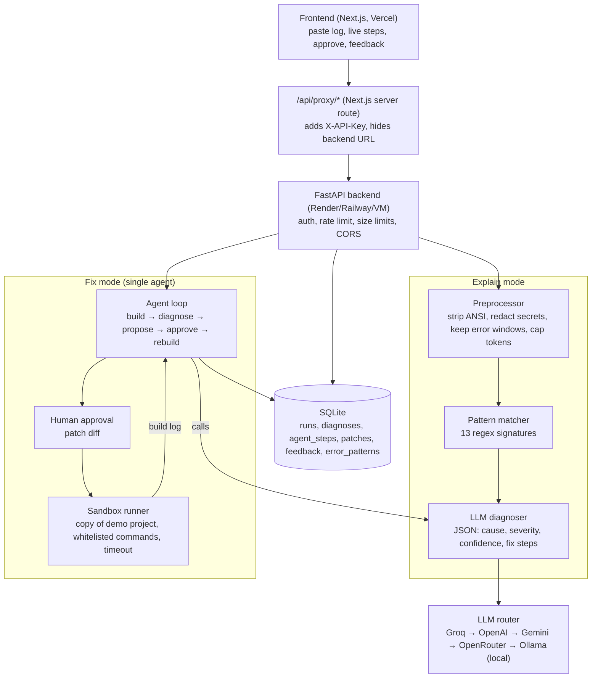

# Architecture

Both modes share one diagnoser; only the agent touches code, and only after approval.

## Request flows

**Explain mode** — `POST /analyze`
1. Validate size (≤ `MAX_LOG_BYTES`), store raw log length only, not secrets.
2. `preprocess.clean()` strips colour codes/timestamps, **redacts secrets**, collapses repeats, keeps ±12 lines around error lines, caps ~10,000 chars.
3. `patterns.match()` runs regex signatures; best hit becomes a hint.
4. `diagnose.diagnose()` sends the cleaned log + hint to the LLM router, asks for strict JSON, validates it with Pydantic, falls back to the pattern's known answer if the LLM fails.
5. Store `runs` + `diagnoses`, return the diagnosis. Feedback goes to `feedback`.

**Fix mode** — `POST /agent/run`
1. Copy `backend/demo/template` + the chosen scenario overlay into `backend/runs/<run_id>/` (sandbox).
2. Agent loop (background task): `run_build` → if exit 0: `fixed`. Else diagnose the build log. If `auto_fixable` is false → `handed_off` with manual steps. Else ask the LLM (tool calling) for **one** action: `propose_edit(path, old, new)` or `install_package(name)`.
3. Action becomes a row in `patches` (`pending`). Status `awaiting_approval` until `POST /patches/{id}/decision` (or `AUTO_APPROVE=true`).
4. Apply, log the step, rebuild. Stop at success, hand-off, or `AGENT_MAX_ATTEMPTS`.
5. UI polls `GET /runs/{id}` every second and renders the step log and diffs.

## Module map (backend/app)

| File | Job |
|---|---|
| `main.py` | App factory, CORS, rate limit, routers, startup (init DB, seed patterns) |
| `config.py` | Settings from env (pydantic-settings) |
| `security.py` | API-key dependency, secret redaction, safe path join |
| `db.py` + `schema.sql` | SQLite connection, schema, seed, query helpers |
| `models.py` | Pydantic request/response models |
| `core/llm.py` | OpenAI-compatible client per provider, fallback chain, JSON mode |
| `core/preprocess.py` | Log cleaning, redaction, error windows |
| `core/patterns.py` | Regex matcher over `data/patterns.json` |
| `core/diagnose.py` | Diagnosis prompt + parsing + pattern fallback |
| `core/sandbox.py` | Sandbox copy, whitelisted command runner (STUB) |
| `core/agent.py` | Single-agent loop and tools (STUB) |
| `routes/explain.py` | `/analyze`, `/feedback`, `/stats`, `/patterns`, `/samples` |
| `routes/fix.py` | `/demo/*`, `/agent/run`, `/runs/{id}`, `/patches/{id}/decision` (STUB) |

## Why this design scores well
- **Relevance (30):** every deliverable in the brief, real deployment pain.
- **Innovation (15):** agent proves its fix by re-running the build; knows when to hand off.
- **Feasibility/scalability (15):** stateless API + SQLite today → Postgres tomorrow; patterns grow as data; frontend and backend scale separately.
- **AI/ML/GenAI (20):** hybrid rules + LLM, confidence scores, tool-calling agent, offline local model, feedback loop.
- **Teamwork (20):** five clear owners (see `IMPLEMENTATION_PLAN.md`).
